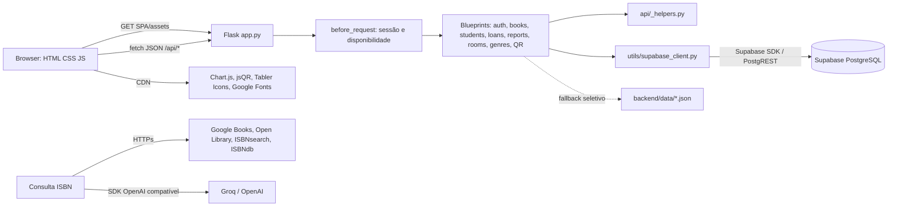

# 02 — Arquitetura do sistema

## Visão observada

O Flask serve tanto a interface estática quanto os endpoints `/api/*`. O
JavaScript chama a API por `fetch` na mesma origem. A aplicação consulta o
Supabase pela biblioteca Python, por meio do adaptador central em
`backend/utils/supabase_client.py`. Há arquivos JSON locais usados por alguns
módulos em erros/fallback, mas o middleware `require_database_for_api` faz uma
consulta ao Supabase antes de liberar a maioria das rotas de negócio.

## Caminho de uma requisição

1. `backend/app.py` recebe a requisição.
2. Para `/api/*`, os `before_request` limitam a sessão `self_service` e verificam
   disponibilidade do banco, com exceções explícitas para health, config e
   consulta de ISBN.
3. O blueprint correspondente interpreta query/body e chama utilitários.
4. As consultas são montadas pelo cliente Supabase; funções como `sb_exec`
   executam e extraem `data`.
5. O endpoint produz JSON/CSV/PNG e status HTTP. Os handlers globais convertem
   `HTTPException` em JSON e outros erros em 500 genérico.
6. O frontend atualiza Store/DOM e mostra o resultado.

## Camadas e responsabilidades

- **Apresentação:** `frontend/index.html`, CSS e scripts vanilla; não há framework
  SPA identificado no manifesto.
- **Cliente HTTP:** `frontend/assets/js/api.js`; serializa JSON, lê resposta e
  registra erros no console.
- **Aplicação/API:** Flask blueprints em `backend/api/` e `backend/scanner/`.
- **Persistência:** Supabase para dados de negócio; JSON para fallback e
  permissões locais do autoatendimento.
- **Integrações externas:** consulta bibliográfica e modelos de linguagem/visão
  implementados sobretudo em `backend/api/books.py`.

## Sessão e autorização observadas

O Flask assina o cookie de sessão com `SECRET_KEY` (há fallback fixo no código).
Login administra `access_scope`; alguns controles verificam esse valor, mas não
há decorator RBAC geral aplicado às rotas CRUD. O middleware é específico:
restringe a sessão de autoatendimento e configurações de operações, mas não
substitui autenticação/autorização de todas as rotas.

## Erros e indisponibilidade

- `GET /api/health` confirma somente que Flask responde.
- `GET /api/ready` tenta consultar `livros` no Supabase e responde 503 se falhar.
- O middleware retorna 503 para várias rotas se o banco não estiver disponível.
- Alguns módulos ainda tentam ler/escrever JSON em exceções; esse fallback não
  equivale a uma garantia de modo offline completo.

## Componentes não confirmados

Não foi testado um deploy real, conectado a Supabase, nem o tráfego de navegador
para CDNs. O arquivo frontend de configuração Supabase existe, porém a página
não carrega uma tag do SDK Supabase e o cliente HTTP normal usa Flask; uso efetivo
do cliente direto no browser não foi confirmado.
