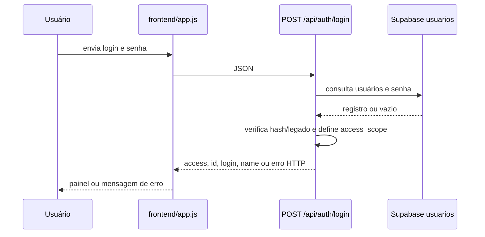
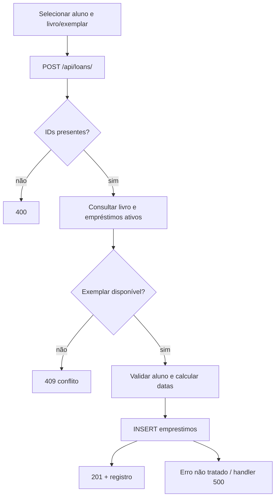

# 04 — Fluxos do sistema

## Login administrativo

## Empréstimo de exemplar

Não há transação explícita envolvendo seleção de disponibilidade e INSERT. O
índice SQL de exemplar ativo é uma proteção adicional, mas não substitui resposta
de concorrência testada.

## Autoatendimento

1. O administrador configura `enabled` e permissões em
   `backend/data/self_service_settings.json`.
2. A leitura de cartão chama `POST /api/auth/self-service/login`.
3. O backend valida a carteirinha e emite token assinado e sessão restrita.
4. Consulta de histórico exige Bearer token e confere que `student_id` coincide
   com a sessão.
5. Operações de empréstimo/devolução/renovação verificam permissões e propriedade.
6. O middleware bloqueia chamadas não permitidas à sessão `self_service`.

As configurações são armazenadas em arquivo JSON local, não no banco; implantação
em filesystem efêmero pode perder essas preferências. Isso é uma implicação da
implementação, não foi validado em uma plataforma hospedada.

## Cadastro por ISBN

1. Frontend chama `GET /api/books/isbn-lookup` ou envia frame para
   `POST /api/books/isbn-vision`.
2. Backend valida ISBN/frame.
3. Consulta fontes externas (paralelo/fallback); opcionalmente consulta modelo.
4. Combina título, autor, categorias e gênero.
5. Frontend preenche formulário; criação final é `POST /api/books/`.

## QR

O scanner pode usar `BarcodeDetector`/`jsQR` no browser e também mandar imagem a
`POST /api/qr/decode`, onde Pillow/OpenCV/pyzbar tentam decodificar. O backend
resolve o texto em livro, aluno, exemplar ou prefixo de cartão administrativo.
Cartão administrativo exige senha no endpoint de login; aluno com
`is_librarian=true` recebe escopo bibliotecário.

## Relatórios

`GET /api/reports/data` agrega livros, alunos, empréstimos e salas, calcula
situações e retorna relatórios. Endpoints `/export/*` convertem as linhas em CSV
com BOM UTF-8. A geração mensal calcula totais e faz upsert por `mes_ano`.

## Caminhos de erro relevantes

- Banco indisponível: middleware pode impedir a rota com 503 antes do fallback
  local do módulo.
- ISBN inválido: 400; livro ausente: 404; provedores indisponíveis: 502.
- Token de autoatendimento inválido/expirado: 401.
- Exemplar indisponível ou operação desativada: 409/403.
- Erros inesperados chegam ao handler genérico e retornam 500.

Não foram testados fluxos ponta a ponta em navegador, banco real ou provedores
externos.
