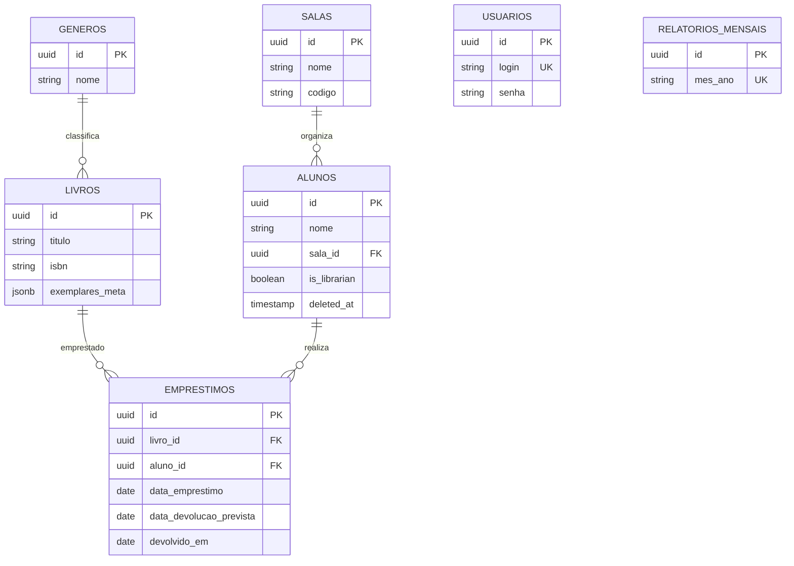

# 07 — Banco de dados

## Tecnologia e confirmação

`database.sql` contém DDL PostgreSQL e `backend/utils/supabase_client.py` cria o
cliente Python Supabase. O schema em produção não foi consultado; a descrição
abaixo é do script versionado, não uma confirmação do banco remoto.

## Entidades

| Tabela | Chaves e campos notáveis | Relações/uso |
|---|---|---|
| `usuarios` | UUID PK, `login` único, senha, nome | Autenticação administrativa |
| `salas` | UUID PK, nome, código, capacidade | Referenciada por alunos |
| `generos` | UUID PK, nome, ícone, cor | Referenciada por livros |
| `livros` | UUID PK, ISBN, título, autor, gênero, quantidade e JSONB de exemplares | Catálogo |
| `alunos` | UUID PK, carteirinha, turma, sala, flag bibliotecário, `deleted_at` | Empréstimos e identidade |
| `emprestimos` | UUID PK, datas, livro/aluno, exemplar, renovações | Histórico de empréstimos |
| `relatorios_mensais` | UUID PK, `mes_ano` único, totais e agregados JSONB | Relatórios gerados |

`salas` e `generos` têm FKs com `ON DELETE SET NULL`; empréstimos referenciam
livros e alunos com `ON DELETE CASCADE`. Índices cobrem ISBN/título/área/gênero,
carteirinha/nome/turma/sala e campos de empréstimo. Há índice único parcial em
`emprestimos(livro_id, exemplar)` para `devolvido_em IS NULL`.

## RLS, views e scripts

RLS é habilitado nas sete tabelas. Políticas `USING (true)`/`WITH CHECK (true)`
permitem acesso amplo conforme grants/role do PostgreSQL; em `usuarios` existe
policy de SELECT ampla. Não há política de ownership no SQL analisado. `service
role` do Supabase contorna RLS.

Views `vw_emprestimos_ativos` e `vw_livros_ranking` são definidas no SQL. A busca
no código consultado não confirmou consumo dessas views.

**Atenção:** no início do script há `DROP ... CASCADE` em tabelas/views. Executar
o script novamente em base existente pode apagar objetos e dados dependentes.
O script também insere contas iniciais com senhas em texto literal.

## Operações no código

Os módulos `books.py`, `students.py`, `loans.py`, `reports.py`, `rooms.py`,
`genres.py`, `auth.py` e `scanner/routes.py` fazem consultas/escritas por
`sb.table(...).select/insert/update/delete/upsert`. Não há ORM nem migrations
incrementais identificadas. Arquivos em `backend/data/` são fallback local; o
middleware global exige consulta Supabase para a maioria das rotas.

Nenhuma conexão, transação, escrita ou leitura em banco real foi executada.
